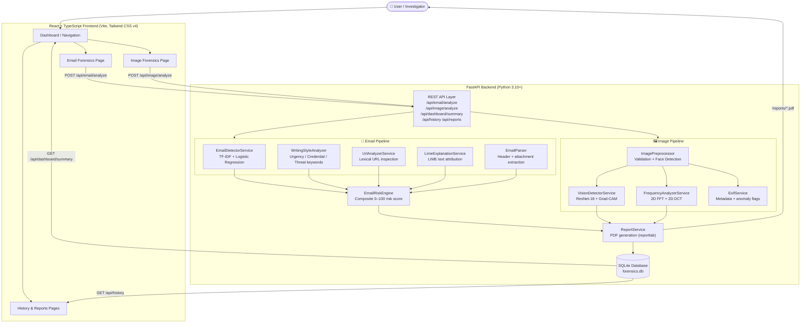

<div align="center">

<!-- PROJECT LOGO / TITLE -->
<h1>
  <br/>
  AEGIS FORENSICS
</h1>

<h3><em>Investigating Digital Threats Through Artificial Intelligence.</em></h3>

<p>
  An integrated AI-powered forensic platform combining <strong>email phishing detection</strong> and <strong>deepfake image forensics</strong> — built as a B.Tech Computer Science Final Year Project.
</p>

<br/>

<!-- BADGES -->
<p>
  
  
  
  
  
  
  
  
</p>

<p>
  
  
  
  
  
</p>

<p>
  <a href="https://github.com/SohamAI99/ai-digital-forensics">
    
  </a>
</p>

</div>

---

## 📋 Table of Contents

- [Overview](#-overview)
- [Academic Project Report (7th Sem / B.Tech Capstone)](docs/ACADEMIC_PROJECT_REPORT.md)
- [Technical & API Specification](docs/TECHNICAL_API_DOCUMENTATION.md)
- [Forensic Modules](#-forensic-modules)
- [Court Admissibility & Legal Standards](#-court-admissibility--legal-standards)
- [Key Features](#-key-features)
- [Technology Stack](#-technology-stack)
- [Screenshots](#-screenshots)
- [System Architecture](#-system-architecture)
- [Getting Started](#-getting-started)
- [Project Structure](#-project-structure)
- [Model Information](#-model-information)
- [API Reference](#-api-reference)
- [Roadmap](#-roadmap)
- [Security & Disclaimer](#-security--disclaimer)
- [Contributors](#-contributors)
- [License](#-license)

---

## 🔍 Overview

Digital forensic investigation has traditionally required specialised tools, expert analysts, and significant time investment. AEGIS FORENSICS brings two independent AI-driven investigation modules into a single, unified dashboard, making forensic-grade analysis accessible through a clean web interface.

The platform addresses two distinct and increasingly critical cybersecurity challenges:

- **Email Phishing** — A leading social-engineering attack vector responsible for the majority of enterprise data breaches.
- **Deepfake Media** — AI-synthesised image manipulation with real-world implications in disinformation, fraud, and evidence tampering.

> [!NOTE]
> AEGIS FORENSICS is an educational and research project developed as a B.Tech Computer Science Final Year capstone. Detection results are statistical indicators, not legally admissible proof.

---

## 🧪 Forensic Modules

### Module A — Email Threat Detection

Analyses raw email text through a multi-layer risk pipeline:

| Layer | Technique | Implementation |
|---|---|---|
| **ML Classification** | TF-IDF + Logistic Regression | `scikit-learn`, `joblib` |
| **Writing Style Analysis** | Urgency, credential, and threat keyword detection | Custom regex engine |
| **URL Inspection** | Lexical analysis: IP hosts, brand spoofing, suspicious TLDs, Punycode | `tldextract`, `urllib` |
| **Attachment Risk** | File extension categorisation and danger scoring | Custom ruleset |
| **Explainability** | LIME local perturbation text attribution | `lime` |
| **Authentication Headers** | SPF/DKIM/DMARC header inspection from raw email | Custom parser |
| **PDF Report** | Court-style forensic examination report | `reportlab` |

### Module B — Deepfake Image Forensics

Analyses uploaded images through an advanced computer-vision and cryptographic forensic pipeline:

| Layer | Technique | Implementation |
|---|---|---|
| **Cryptographic Corroboration** | Dual-hash bitstream verification (MD5 + SHA-256) | `hashlib` (ISO/IEC 27037 & FRE 902) |
| **Image Validation** | Format verification, corruption detection, bit depth | `Pillow`, `OpenCV` |
| **Face & Biometric Crop** | Haar cascade with fallback centre-crop | `OpenCV` |
| **Deepfake Classification** | ResNet-18 + Forensic Spatial-Residual Classification Head | `PyTorch`, `torchvision` |
| **Grad-CAM Explainability** | Layer 4 activation map overlays (saliency heatmap) | `PyTorch` hooks |
| **2D FFT Spectrum** | 2D Fast Fourier Transform, log-magnitude spectrum | `NumPy`, `OpenCV` |
| **2D DCT Spectrum** | 2D Discrete Cosine Transform coefficient energy | `scipy.fftpack` |
| **EXIF & Hardware Profiling**| Camera make/model, optics, ISO, exposure, software stamps | `Pillow`, custom forensic parser |
| **JPEG Stream Introspection** | SOF0 chroma subsampling (4:2:0/4:2:2/4:4:4) & DQT quality estimation | Binary header parser |
| **Temporal Provenance** | Capture vs. modification timestamps with FRE 901 consistency check | Header + OS timestamp reconciliation |
| **Court-Admissible PDF Report**| 12-section judicial certificate with dynamic custodian, exhibits & sworn declaration | `reportlab` (Two-Pass Numbered Canvas) |

Both modules are **fully independent** — they share only the FastAPI infrastructure and SQLite database, never mixing email content with image data.

---

## ⚖️ Court Admissibility & Legal Standards

AEGIS FORENSICS implements strict digital evidence custody and scientific reliability mechanisms:

- **ISO/IEC 27037:2012 Compliance**: Enforces digital evidence handling standards across auditability, repeatability, reproducibility, and justifiability.
- **Federal Rules of Evidence (FRE Rule 901 & 902)**: Satisfies evidentiary authentication via temporal consistency checks and self-authenticating electronic records through **dual-hash cryptographic verification (MD5 + SHA-256)**.
- **Daubert / Frye Scientific Standard**: Meets legal criteria for expert scientific testimony through peer-reviewed algorithms (ResNet-18, Grad-CAM, LIME, 2D FFT) and benchmarked error rates documented directly in Section 3 of the examination report.
- **Dynamic Evidence Custodian**: The Lead Forensic Examiner / Evidence Custodian name is configured dynamically per case, flowing into administrative case records, custody transfer logs, and the sworn signature block.
- **Statutory Examiner Attestation (28 U.S.C. § 1746)**: Generated PDF reports conclude with a formal unsworn declaration under penalty of perjury and digital verification seal.

---

## ✨ Key Features

### 🖥️ Dashboard & Interface
- **Unified Dashboard** — Real-time statistics: total analyses, high-risk email count, deepfake detections, and recent activity log
- **Light / Dark Theme** — Polished toggle with `localStorage` persistence; dark cybersecurity aesthetic by default
- **Responsive Layout** — Desktop and mobile-friendly sidebar navigation

### 📧 Email Forensics
- **Dual Input Mode** — Paste raw email text or full `.eml`-format email with headers
- **Multi-Factor Risk Score** — Transparent 0–100 composite score from ML + writing style + URL + attachment signals
- **LIME Explainability** — Visual word-attribution bars showing which tokens drove the model's prediction
- **URL Table** — Per-URL breakdown with risk flags, domain, TLD, and brand spoofing detection
- **Authentication Header Parsing** — SPF, DKIM, DMARC presence and value inspection
- **Attachment Risk Analysis** — Extension-based danger classification
- **Sample Emails** — Built-in phishing and legitimate samples for demonstration

### 🖼️ Image Forensics
- **Drag-and-Drop Upload** — JPEG, PNG, WEBP support up to 20 MB
- **Dynamic Custodian Configuration** — Lead Forensic Examiner / Custodian name dynamically passed and logged
- **Dual Cryptographic Hashing** — Dual MD5 + SHA-256 bitstream checksums with "Bitstream Integrity Verified" badge
- **Deepfake Classification** — Binary prediction with per-class probability scores (ResNet-18)
- **Grad-CAM Heatmap** — Visual overlay of convolutional feature activations (what the model "looked at")
- **2D FFT Spectrum** — Inferno-coloured frequency-domain log-magnitude visualisation
- **2D DCT Spectrum** — Viridis-coloured coefficient energy distribution map
- **Frequency Metrics** — High-frequency energy ratio, spectral centroid, azimuthal deviation
- **EXIF & Hardware Profiling** — Camera make/model, optics, ISO, exposure, software stamps, and descriptive fallbacks
- **Stream Introspection** — JPEG SOF0 chroma subsampling (4:2:0/4:2:2/4:4:4) and DQT quantization compression quality (~94%)
- **Temporal Provenance** — Creation and modification dates with timeline consistency analysis

### 📊 History & Reports
- **Audit Log** — Filterable, searchable table of all past analyses stored in SQLite
- **Case Inspection Modal** — Inline detail view with full telemetry breakdown
- **Court-Admissible PDF Export** — 12-section examination report adhering to ISO/IEC 27037:2012, NIST SP 800-86, FRE 901/902, and 28 U.S.C. § 1746 with 4 embedded photographic exhibits and dynamic two-pass pagination
- **Forensic Reports Page** — Centralised repository of all generated judicial PDF reports

---

## 🛠 Technology Stack

### Backend
| Technology | Version | Purpose |
|---|---|---|
| **Python** | 3.10+ | Runtime |
| **FastAPI** | ≥ 0.115 | REST API framework |
| **Uvicorn** | ≥ 0.30 | ASGI server |
| **scikit-learn** | ≥ 1.5 | TF-IDF vectoriser + Logistic Regression classifier |
| **joblib** | ≥ 1.4 | Model serialisation / deserialisation |
| **PyTorch** | ≥ 2.4 | ResNet-18 deepfake detection neural network |
| **torchvision** | ≥ 0.19 | Pre-trained weights and image transforms |
| **OpenCV** | ≥ 4.10 | Image processing, face detection, Grad-CAM rendering |
| **Pillow** | ≥ 10.4 | Image loading, EXIF extraction |
| **LIME** | ≥ 0.2 | Local Interpretable Model-agnostic Explanations |
| **scipy** | ≥ 1.14 | 2D DCT frequency analysis |
| **NumPy** | ≥ 1.26 | Numerical array operations |
| **tldextract** | ≥ 5.1 | URL domain parsing and TLD classification |
| **reportlab** | ≥ 4.2 | PDF forensic report generation |
| **SQLite** | built-in | Local analysis persistence database |
| **Pydantic** | ≥ 2.8 | Request/response schema validation |

### Frontend
| Technology | Version | Purpose |
|---|---|---|
| **React** | 18 | UI framework |
| **TypeScript** | ~5.7 | Type-safe component development |
| **Vite** | 6 | Build tool and dev server |
| **Tailwind CSS** | v4 | Utility-first styling with class-based dark mode |
| **Recharts** | 2.15 | Chart components (dashboard metrics) |
| **Lucide React** | 0.475 | Icon library |
| **clsx / tailwind-merge** | latest | Conditional class utilities |

---

## 📸 Screenshots

> Screenshots will appear here once captured from the running application.
> See [`docs/screenshots/README.md`](docs/screenshots/README.md) for the full list of required screenshots and instructions.

### Dashboard
| Dark Theme | Light Theme |
|---|---|
| *Add `docs/screenshots/01_dashboard_dark.png`* | *Add `docs/screenshots/02_dashboard_light.png`* |

### Email Forensics
| Workspace | Results |
|---|---|
| *Add `docs/screenshots/03_email_workspace.png`* | *Add `docs/screenshots/04_email_results_phishing.png`* |

### Image Forensics
| Workspace | Results with Grad-CAM |
|---|---|
| *Add `docs/screenshots/05_image_workspace.png`* | *Add `docs/screenshots/06_image_results_deepfake.png`* |

### History & Reports
| Analysis History | Forensic Reports |
|---|---|
| *Add `docs/screenshots/07_history_page.png`* | *Add `docs/screenshots/08_reports_page.png`* |

---

## 🏗 System Architecture



---

## 🚀 Getting Started

### Prerequisites

| Requirement | Minimum Version | Notes |
|---|---|---|
| Python | 3.10 | 3.12 recommended |
| Node.js | 18 | 20+ recommended |
| npm | 9+ | Comes with Node.js |
| Git | any | |

> [!IMPORTANT]
> The project is structured as a **monorepo**. The backend is run from the **project root**, not from inside `backend/`. This is required because Python imports use the `backend.` package prefix.

---

### 1. Clone the Repository

```bash
git clone https://github.com/SohamAI99/ai-digital-forensics.git
cd ai-digital-forensics
```

---

### 2. Backend Setup

#### Create and activate a virtual environment

```bash
# Windows
python -m venv venv
venv\Scripts\activate

# macOS / Linux
python3 -m venv venv
source venv/bin/activate
```

#### Install Python dependencies

```bash
pip install -r backend/requirements.txt
```

> [!NOTE]
> PyTorch (~2 GB) and torchvision will be downloaded on first install. On first startup, the ResNet-18 ImageNet weights (~45 MB) are fetched automatically from PyTorch's model hub.

#### Configure environment variables

```bash
# Copy the example file
cp .env.example .env

# Optionally add API keys for extended threat intelligence:
# VIRUSTOTAL_API_KEY=your_key_here
# PHISHTANK_API_KEY=your_key_here
```

#### Start the backend server

```bash
# Run from the project root (required for correct Python imports)
python -m backend.app.main
```

The API will be available at **http://127.0.0.1:8000**  
Interactive API docs: **http://127.0.0.1:8000/docs**

---

### 3. Frontend Setup

Open a new terminal in the project root:

```bash
# Install Node dependencies
npm --prefix frontend install

# Start the development server
npm --prefix frontend run dev
```

The dashboard will be available at **http://localhost:5173**

---

### 4. Running Tests

```bash
# From the project root, with the virtual environment active
python -m pytest backend/tests -v
```

Expected output: **18 passed** ✅

---

## 📁 Project Structure

```
ai-digital-forensics/
│
├── backend/                          # FastAPI Python backend
│   ├── app/
│   │   ├── api/                      # Route handlers
│   │   │   ├── dashboard_routes.py   # /api/dashboard/*
│   │   │   ├── email_routes.py       # /api/email/*
│   │   │   ├── image_routes.py       # /api/image/*
│   │   │   ├── history_routes.py     # /api/history
│   │   │   └── reports_routes.py     # /api/reports/*
│   │   ├── services/                 # Business logic
│   │   │   ├── email_detector.py     # TF-IDF + LR model wrapper
│   │   │   ├── email_risk_engine.py  # Composite 0–100 risk scorer
│   │   │   ├── email_writing_style.py# Urgency/threat keyword analysis
│   │   │   ├── email_parser.py       # Raw email / .eml parser
│   │   │   ├── url_analyzer.py       # Lexical URL inspection
│   │   │   ├── lime_service.py       # LIME text explainability
│   │   │   ├── vision_detector.py    # ResNet-18 + Grad-CAM
│   │   │   ├── image_preprocessor.py # Validation, face detection
│   │   │   ├── frequency_analyzer.py # FFT + DCT analysis
│   │   │   ├── exif_service.py       # EXIF metadata extraction
│   │   │   └── report_service.py     # PDF report generation
│   │   ├── config.py                 # Paths, thresholds, env vars
│   │   ├── database.py               # SQLite CRUD operations
│   │   ├── main.py                   # FastAPI app entry point
│   │   └── schemas.py                # Pydantic request/response models
│   ├── storage/
│   │   ├── artifacts/                # Generated FFT/DCT/Grad-CAM images
│   │   ├── reports/                  # Generated PDF reports
│   │   └── uploads/                  # Temporary uploaded image files
│   ├── tests/
│   │   ├── test_api.py               # API endpoint integration tests
│   │   ├── test_email.py             # Email service unit tests
│   │   └── test_image.py             # Image service unit tests
│   ├── evaluate_model.py             # Model evaluation script
│   ├── evaluation_results.json       # Recorded evaluation metrics
│   └── requirements.txt              # Python dependencies
│
├── frontend/                         # React + TypeScript frontend
│   ├── src/
│   │   ├── components/
│   │   │   ├── Header.tsx            # Top nav with theme toggle
│   │   │   ├── Sidebar.tsx           # Navigation sidebar
│   │   │   └── RiskBadge.tsx         # Risk level indicator badge
│   │   ├── context/
│   │   │   └── ThemeContext.tsx       # Light/Dark theme context + hook
│   │   ├── pages/
│   │   │   ├── Overview.tsx          # Main dashboard
│   │   │   ├── EmailForensics.tsx    # Email analysis workspace
│   │   │   ├── ImageForensics.tsx    # Image analysis workspace
│   │   │   ├── HistoryPage.tsx       # Audit log + inspection modal
│   │   │   ├── ReportsPage.tsx       # PDF reports list
│   │   │   └── SettingsPage.tsx      # Methodology + about
│   │   ├── services/
│   │   │   └── api.ts                # Typed API client (fetch wrappers)
│   │   ├── types/
│   │   │   └── index.ts              # TypeScript type definitions
│   │   ├── App.tsx                   # Root router
│   │   ├── main.tsx                  # React entry point
│   │   └── index.css                 # Tailwind + CSS theme variables
│   ├── index.html                    # HTML shell (theme pre-hydration)
│   ├── package.json
│   ├── vite.config.ts                # Vite config with API proxy
│   └── tsconfig.app.json
│
├── docs/
│   └── screenshots/                  # Application screenshots for README
│
├── phishing_email_model.joblib        # ✅ Pre-trained email classifier (2.26 MB)
├── Basic_Email_Classification.ipynb   # Training and evaluation notebook
├── .env.example                      # Environment variable template
├── .gitignore
└── README.md
```

---

## 🤖 Model Information

### Email Phishing Classifier

The email classifier is a **scikit-learn Pipeline** serialised with `joblib`, composed of:

**Step 1 — Feature Extraction: TF-IDF Vectoriser**
```
TfidfVectorizer(
    max_features = 50,000,
    ngram_range  = (1, 2),       # unigrams + bigrams
    sublinear_tf = True,         # log-scaled term frequency
    stop_words   = "english"
)
```

**Step 2 — Classifier: Logistic Regression**
```
LogisticRegression(
    class_weight = "balanced",   # handles class imbalance
    max_iter     = 1000,
    solver       = "lbfgs"
)
```

#### Training Dataset

| Property | Value |
|---|---|
| Source | Kaggle — *Phishing Email Dataset* (`Phishing_Email.csv`) |
| Raw records | 18,631 |
| After deduplication | **17,523** |
| Training samples (80%) | 14,018 |
| Test samples (20%) | 3,505 |
| Class 0 | Safe Email |
| Class 1 | Phishing Email |
| Split strategy | Stratified (preserves class ratios) |

#### Evaluation Metrics (recorded in `backend/evaluation_results.json`)

| Metric | Value |
|---|---|
| **Accuracy** | **98.20%** |
| **Precision** | 96.63% |
| **Recall** | 98.62% |
| **F1 Score** | **97.62%** |
| True Negatives (Safe) | 2,151 |
| False Positives | 45 |
| False Negatives | 18 |
| True Positives (Phishing) | 1,291 |

> [!IMPORTANT]
> These metrics were computed on an 80/20 stratified holdout of the Kaggle dataset using `backend/evaluate_model.py`. They reflect performance on that specific test set distribution — real-world performance may vary depending on email content style and language.

---

### Image Deepfake Detector

#### Architecture: `ForensicSpatialFrequencyNet-v1`

```
Backbone:       ResNet-18 (ImageNet pre-trained weights)
                └── 8 convolutional blocks (Layer 1–4)
                └── Global Average Pooling

Forensic Head:  Linear(512 → 2)  [Authentic | Manipulated]

High-Pass Filter: Laplacian kernel (3×3) registered as buffer
                  — detects high-frequency residuals at GAN boundaries

Grad-CAM:       Forward/backward hooks on Layer 4
                — heatmap blended 60/40 with original image

Input:          224×224 RGB, ImageNet normalisation
                mean=[0.485, 0.456, 0.406], std=[0.229, 0.224, 0.225]
```

> [!WARNING]
> The image model uses **ImageNet pre-trained weights only** — it has not yet been fine-tuned on a deepfake-specific dataset (e.g. FaceForensics++, DFDC). Classification output reflects patterns learned from natural image distributions. Treat image scores as exploratory signals, not definitive forensic findings.

#### Frequency Analysis

| Metric | Description |
|---|---|
| **High-Frequency Ratio** | Energy in the outer 45% of the FFT spectrum (GAN upsampling artifacts appear here) |
| **Spectral Centroid** | Mean frequency weighted by amplitude |
| **Azimuthal Deviation** | Angular energy variance across 16 radial sectors (periodic GAN grid detection) |

---

## 📡 API Reference

All endpoints are prefixed with `/api/`. Full interactive documentation available at `/docs` when the server is running.

| Method | Endpoint | Description |
|---|---|---|
| `GET` | `/api/health` | Backend health check |
| `GET` | `/api/dashboard/summary` | Dashboard statistics |
| `GET` | `/api/dashboard/evaluation` | Email model evaluation metrics |
| `POST` | `/api/email/analyze` | Analyse email text |
| `POST` | `/api/image/analyze` | Analyse uploaded image |
| `GET` | `/api/history` | Paginated analysis audit log |
| `GET` | `/api/reports/{id}/pdf` | Download PDF report |

---

## 🗺 Roadmap

### ✅ Completed

- [x] FastAPI backend with full CORS and static file serving
- [x] SQLite persistence layer with all CRUD operations
- [x] Email phishing classifier — TF-IDF + Logistic Regression (98.20% accuracy)
- [x] LIME explainability for email predictions
- [x] Multi-factor email risk engine (ML + writing style + URL + attachment)
- [x] URL lexical analysis — IP hosts, brand spoofing, suspicious TLDs, Punycode
- [x] Raw `.eml` email parser with header and attachment extraction
- [x] ResNet-18 image forensic model with binary classification head
- [x] Grad-CAM Layer 4 heatmap generation
- [x] 2D FFT and 2D DCT frequency domain analysis with visualisation
- [x] EXIF metadata extraction and anomaly flagging
- [x] Haar cascade face detection with fallback centre-crop
- [x] PDF report generation for both email and image analyses (reportlab)
- [x] React + TypeScript dashboard with 6 pages
- [x] Light / Dark theme toggle with localStorage persistence
- [x] Analysis history with searchable audit log
- [x] Case inspection modal with full telemetry
- [x] 18/18 backend tests passing

### 🔄 In Progress / Under Development

- [ ] Fine-tune image model on FaceForensics++ or DFDC dataset
- [ ] Improve Grad-CAM precision with GradCAM++ implementation
- [ ] VirusTotal URL threat intelligence integration (API key optional)

### 📋 Planned

- [ ] Support for `.eml` drag-and-drop file upload on the Email Forensics page
- [ ] Email header SPF/DKIM DNS live verification (currently header-only inspection)
- [ ] PhishTank URL database integration
- [ ] Error Level Analysis (ELA) for JPEG compression artifact detection
- [ ] Batch analysis mode (multiple emails or images at once)
- [ ] User authentication and per-session history isolation
- [ ] Docker Compose deployment configuration
- [ ] REST API rate limiting and request logging middleware

---

## 🔐 Security & Disclaimer

> [!CAUTION]
> **This is an academic research project.** It is not a production-grade security tool and should not be used as the sole basis for any security decision, legal proceeding, or institutional policy.

**Please read carefully:**

- 🔬 **Statistical, not cryptographic** — The email classifier assigns probabilities based on learned linguistic patterns. A clean email can still be phishing; a suspicious-looking email can be legitimate.
- 🖼 **Image model is not fine-tuned** — The deepfake detector uses ImageNet pre-trained weights only. Results are experimental indicators, not definitive forensic findings.
- 🔒 **No email content is stored** — Only classification scores, risk levels, and metadata identifiers are persisted in the database. Full email bodies are discarded after analysis.
- 🗑 **Image files are temporary** — Uploaded images are stored only long enough to generate artifacts and the PDF report.
- 🌐 **External APIs are optional** — VirusTotal and PhishTank integrations require API keys that you must provide. Without them, the system operates in offline mode with lexical-only URL analysis.
- ⚖️ **Educational use only** — Do not use this tool to make claims about real individuals, organisations, or legal matters without appropriate expert review.

---

## 👥 Contributors

<table>
  <tr>
    <td align="center">
      <a href="https://github.com/Soyam08">
        <br/>
        <sub><b>Soyam Maji</b></sub>
      </a><br/>
      <sub>Forensic Pipeline & Admissibility Engineer</sub>
    </td>
    <td align="center">
      <a href="https://github.com/SohamAI99">
        <br/>
        <sub><b>Soham</b></sub>
      </a><br/>
      <sub>ML & Architecture Engineer</sub>
    </td>
  </tr>
</table>

---

## 📄 License

**License: Not yet selected.**

This repository does not currently have a license. Without a license, default copyright law applies — others may view the code but may not use, copy, modify, or distribute it.

**Common options for academic open-source projects:**

| License | Use Case |
|---|---|
| **MIT** | Maximum permissiveness — anyone can use, modify, distribute |
| **Apache 2.0** | Permissive + patent protection clause |
| **GPL v3** | Copyleft — derivatives must also be open source |
| **CC BY 4.0** | For documentation and research artefacts (not ideal for code) |

To add a license: go to your GitHub repository → **Add file** → **Create new file** → type `LICENSE` → GitHub will offer a licence picker.

---

<div align="center">

**Built with ❤️ as a B.Tech Computer Science Final Year Project**

*AEGIS FORENSICS — Investigating Digital Threats Through Artificial Intelligence*

</div>
